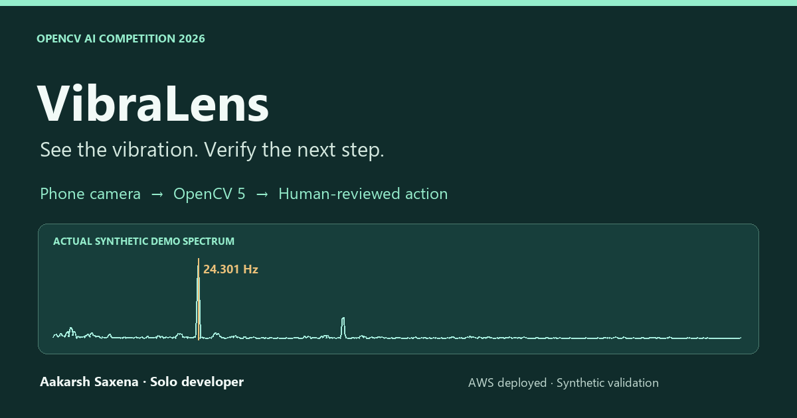
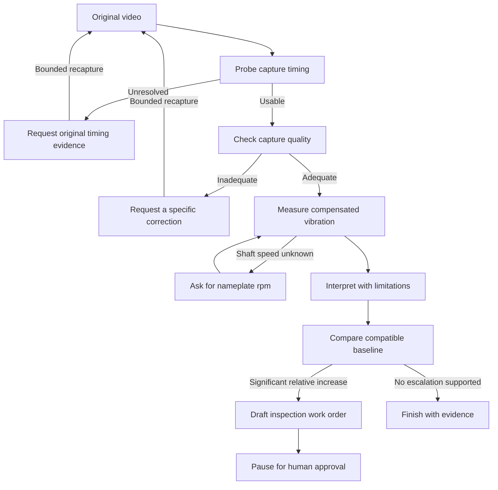
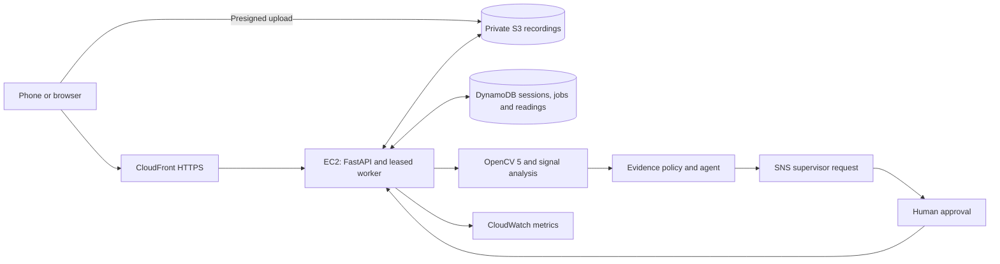

<div align="center">

[](https://www.youtube.com/watch?v=dArWXwFDViY)

# VibraLens

**Help small workshops without vibration sensors spot changes in machine vibration using a slow-motion phone video—and know when a closer inspection is needed.**

[**Live application**](https://dhfpmgo5xkqhh.cloudfront.net/) · [**YouTube demo**](https://www.youtube.com/watch?v=dArWXwFDViY) · [**Judge guide**](https://dhfpmgo5xkqhh.cloudfront.net/judge.html) · [**Technical report**](docs/TECHNICAL_REPORT.md)


[](https://github.com/Aakarsh2007/Vibrations/actions/workflows/checks.yml)

**Aakarsh Saxena · Solo entry · OpenCV AI Competition 2026, powered by AWS**

</div>

## Why VibraLens

A phone camera is easy to find. Dedicated vibration-monitoring equipment is not always within reach of a small workshop. VibraLens explores whether an original slow-motion recording can provide a useful screening signal and guide a technician toward the next measurement or inspection.

The difficult part is deciding when to trust the video. Camera shake, weak marker detail and slow-motion playback timing can produce a plausible but misleading result. VibraLens checks those conditions before interpreting the signal, then requests specific replacement evidence when a capture is inadequate.

> **Prototype scope:** evaluated on synthetic recordings, with a working AWS deployment. No real-machine or accelerometer validation has been performed. The interface shows frequency and relative trends; absolute vibration severity and ISO zones remain disabled.

## Start here

| Resource | What you will find |
|---|---|
| [Live application](https://dhfpmgo5xkqhh.cloudfront.net/) | Four samples processed through the actual hosted OpenCV pipeline |
| [YouTube demo — 4:22](https://www.youtube.com/watch?v=dArWXwFDViY) | Application, agent decisions, architecture and principal results |
| [Judge guide](https://dhfpmgo5xkqhh.cloudfront.net/judge.html) | Testing sequence, report, video and downloadable source archive |
| [Technical report](docs/TECHNICAL_REPORT.md) | Implementation, assumptions, evaluation and responsible use |
| [AWS deployment evidence](docs/AWS_DEPLOYMENT.md) | Verified configuration and hosted workflow results |
| [Machine-readable AWS trace](eval/results/aws_demo.json) | Measurements and decisions from all four hosted workflows |

## Judge walkthrough

No installation or account is required. Use the same browser workspace for the first two examples.

1. Run **Healthy fan (baseline)**. Enter **1458 rpm** if asked. Allow around 1–2 minutes for processing.
2. Run **Same fan with added mass**. The system checks comparability, detects a relative increase and drafts an inspection work order. It pauses for supervisor approval.
3. Run **Bad capture: marker too small**. The agent requests a closer recording.
4. Run **Timing problem**. The agent refuses ambiguous timing and requests the original file.
5. Inspect **Assistant decisions** and select **Download evidence report** to export a session.

The sample names describe synthetic scenarios. A work-order draft requests inspection; it does not establish a mechanical diagnosis. Supervisor emails require confirmation of the SNS subscription.

## What OpenCV 5 does

The intended capture has marker **1** on a stationary machine housing and reference marker **7** on an independent structure. Place markers with the machine switched off.

| Stage | Implementation |
|---|---|
| Physical timing | Frame timestamps, capture-rate metadata and available phone timing profiles |
| Marker tracking | ArUco detection, subpixel corners and invalid-quadrilateral rejection |
| Capture quality | Visibility, marker size, sharpness, exposure, duplicated frames and camera/reference movement |
| Camera compensation | Similarity-transform correction for translation, rotation and scale; homography-based geometric scaling |
| Signal analysis | Frequency and harmonics, Welch band analysis, noise estimates and explicit result classes |
| Next action | Recapture, rpm request, interpretation, compatible-baseline comparison or work-order draft |

OpenCV performs the core visual measurement; NumPy and SciPy handle signal analysis. The dominant peak remains a candidate shaft frequency until supported by rpm evidence.

**Why timing matters:** a **240 fps** recording can be saved with **30 fps** playback timing. Using playback time as physical time would make the estimated frequency **eight times too low**. VibraLens rejects unresolved timing instead of guessing a correction.

## Evidence changes the agent's next action

Each step records allowed actions, the chosen action, state transitions, planner mode and latency. A small marker produces a different request from ambiguous timing; a compatible increase produces a work-order draft.



The verified deployment uses the **deterministic rule planner**. The optional Bedrock integration is constrained by the same policy and falls back to rules on failure; no Bedrock execution is claimed in the reported demo. Approvals are POST-only, expiring, single-use and audited. The application never controls machinery.

## Deployed AWS architecture



**Verified host:** Ubuntu 24.04 · Python 3.12 · OpenCV 5.0.0 · **x86-64 t3.small** · **ap-southeast-2**.

The service uses a workload role, encrypted EBS, IMDSv2 and a CloudFront-restricted origin. Credentials and local login caches are excluded from this repository. **COOL and Graviton acceleration are not used or claimed.** The manual Graviton guide is an alternative, not the configuration used for these results.

[Architecture details](docs/ARCHITECTURE.md) · [Deployment record](docs/AWS_DEPLOYMENT.md) · [CloudFormation template](infra/stack.yaml) · [Runtime health](https://dhfpmgo5xkqhh.cloudfront.net/healthz)

## Measured results

All four workflows passed on AWS. These are **single-run synthetic observations**, not field-accuracy or statistical performance claims.

| Input | Observed AWS result | Workflow time |
|---|---|---|
| Baseline; true frequency **24.3 Hz** | **24.305 Hz**, `COMPLETED` | 74.6 s |
| Stronger motion; true frequency **24.3 Hz** | **24.301 Hz**, `HUMAN_APPROVAL_REQUIRED` | 78.0 s |
| Tiny marker | `RECAPTURE_REQUIRED`: `marker_too_small` | 29.0 s |
| Untagged slowed playback | `RECAPTURE_REQUIRED`: `timing_unreliable` | 13.9 s |

The comparable pair produced a **1055.7% relative level increase** and a work-order draft. Times include processing, storage, polling and the simulated rpm response. The final local unit/API suite passed **42 tests**. A separate local approval test accepted one decision and rejected reuse with HTTP 409.

[Hosted traces](eval/results/aws_demo.json) · [Four-video analysis](samples/results.json) · [Local agent demo](eval/results/agent_demo.json) · [Verification notes](docs/VERIFICATION.md)

## Run locally

Python **3.12** is the tested version. The repository includes the four input videos, so the initial download is approximately 110 MB.

```bash
git clone https://github.com/Aakarsh2007/Vibrations.git
cd Vibrations
python -m venv .venv
```

Activate the environment:

```powershell
# Windows PowerShell
.\.venv\Scripts\Activate.ps1
```

```bash
# Linux / macOS
source .venv/bin/activate
```

Install the pinned dependencies, run the tests and start the app:

```bash
python -m pip install -r requirements-lock.txt
python -m pytest -q tests
python -m uvicorn vibralens.api:app --port 8000
```

Open **http://localhost:8000**. Local mode uses filesystem persistence and needs no AWS credentials. Set configuration options from [.env.example](.env.example) in the process environment.

### Evaluation and packaging

```bash
# Analyze the recordings against their ground-truth metadata.
python tools/run_scenarios.py samples

# Full source/report archive.
python tools/package_submission.py

# Approximately 6.1 MB attachment for Devpost's 35 MB limit.
python tools/package_judges.py
```

For the local HTTP approval/replay demo, start the server with `VL_DEV=1`, then run `python tools/e2e_demo.py`. Keep `VL_DEV` unset in production. Hosted verification prerequisites are in the [deployment evidence](docs/AWS_DEPLOYMENT.md).

## Deployment and documentation

- [AWS deployment guide](infra/deploy.md): manual setup and automated `deploy_free.py` path.
- [Pinned application dependencies](requirements-lock.txt) and [deployment dependencies](infra/requirements.txt).
- [Dockerfile](Dockerfile): optional container path; its image build and ARM64 installation have not been validated.
- [Video sources and transcript](video/README.md), including the published [YouTube demo](https://www.youtube.com/watch?v=dArWXwFDViY).
- [Submission copy](docs/DEVPOST_FINAL.md) and [release checklist](docs/SUBMISSION.md).

AWS resources consume credits or incur costs according to the account plan. Verify plan and credits before reproducing deployment, and clean up after judging. The scripts do not upgrade the plan or add payment details.

## Limits and next validation

The small-motion synthetic baseline showed substantial amplitude underestimation. At 240 fps the reporting band ends at 96 Hz, and a single camera view misses motion toward or away from the camera. Quality checks address some failure modes but do not establish calibrated uncertainty or reliable fault diagnosis.

Next: simultaneous phone/contact-sensor recordings across multiple machines, speeds and amplitudes, followed by held-out evaluation with frozen thresholds. Timing and accelerometer comparison utilities are provided in [`eval/`](eval/). Absolute severity and ISO reporting should remain disabled until physical validation supports them.

## Repository map

| Location | Purpose |
|---|---|
| [`vibralens/`](vibralens/) | Vision, signal analysis, policy, agent, API and persistence |
| [`web/`](web/) | Application, approval, timing page and judge guide |
| [`tests/`](tests/) | Signal recovery, compensation, timing, policy, security and upload checks |
| [`samples/`](samples/) | Four synthetic videos, ground truth and fresh results |
| [`eval/`](eval/) | Hosted/local traces and physical-validation utilities |
| [`infra/`](infra/) | Infrastructure, deployment, recovery and release tools |
| [`docs/`](docs/) | Technical report, diagrams, evidence and submission materials |
| [`video/`](video/) | Demo MP4, transcript and scene definitions |
| [`tools/`](tools/) | Evaluation, media generation and packaging |

Historical notes remain in [`feasibility/`](feasibility/) and [`workflow.md`](workflow.md). Use the current report and verification notes for final implementation status.
