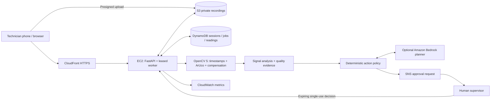
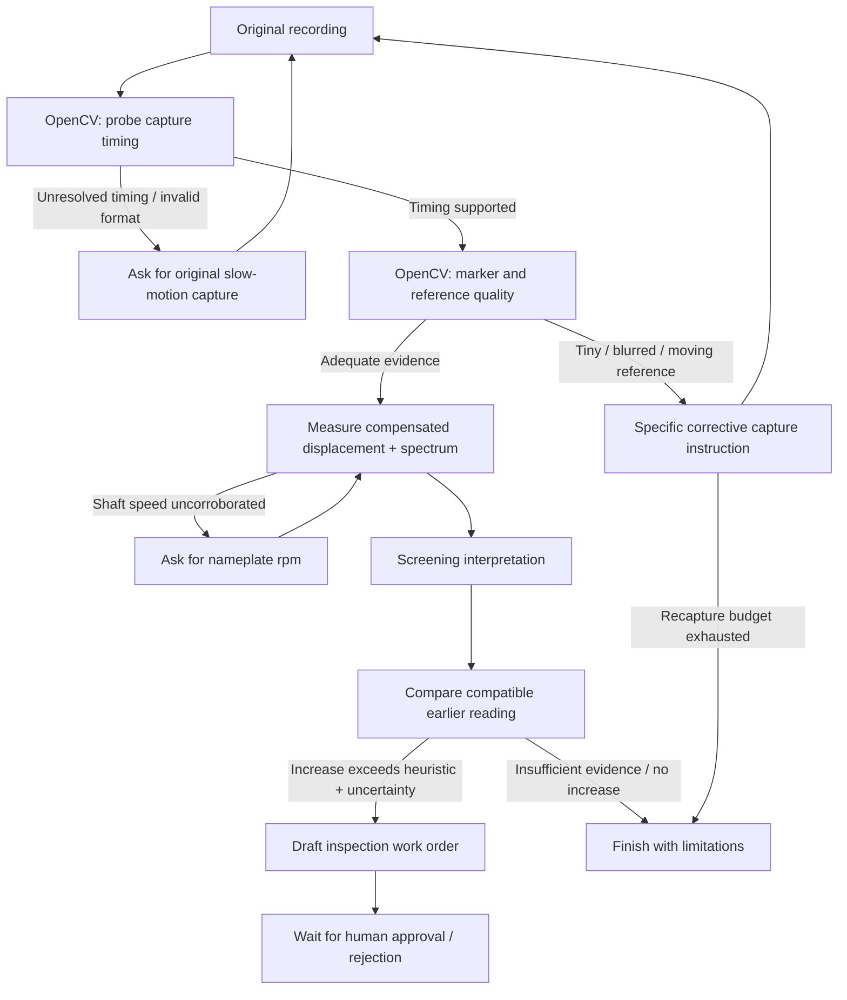

# Architecture and agent workflow

This architecture is deployed at https://dhfpmgo5xkqhh.cloudfront.net/ on an Ubuntu x86-64 t3.small instance in ap-southeast-2. The CloudFormation template provisions services and the instance profile; `infra/deploy_free.py` orchestrates EC2 and HTTPS setup. Hosted health and all four sample workflows were verified. See `AWS_DEPLOYMENT.md` and `eval/results/aws_demo.json`. COOL is not integrated, and no Graviton or Bedrock execution is claimed.

Evidence changes the subsequent tool call: identical code requests a closer recording for the tiny-marker sample and halts before measurement for unresolvable playback timing. The baseline/added-mass pair demonstrates comparison-driven escalation. The end-to-end demonstration records actual state transitions and approval replay rejection.
